# Meydan


**Ten classic games, ten different AI techniques, and a console that shows how each one thinks.**

**▶ Play it in your browser: [numanak-b221210105.github.io/meydan](https://numanak-b221210105.github.io/meydan/)**

Meydan is a neon arcade where every cabinet is a classic game with its own AI opponent. Each AI uses a different idea from the AI textbook: tree search, expectiminimax, Monte Carlo tree search, A*, a probabilistic constraint solver, a genetic algorithm and neuroevolution. Next to every game, an **AI console** shows what the AI is doing right now: the line it is calculating, the moves it is comparing, its win estimate, how many positions it searched, or how its neural network is firing.

Everything runs in the browser, with no server. Heavy searches run in a Web Worker, so the page never freezes.

> *Meydan* is Turkish for "square" or "arena": the place where people gather to play, and where AIs face each other.

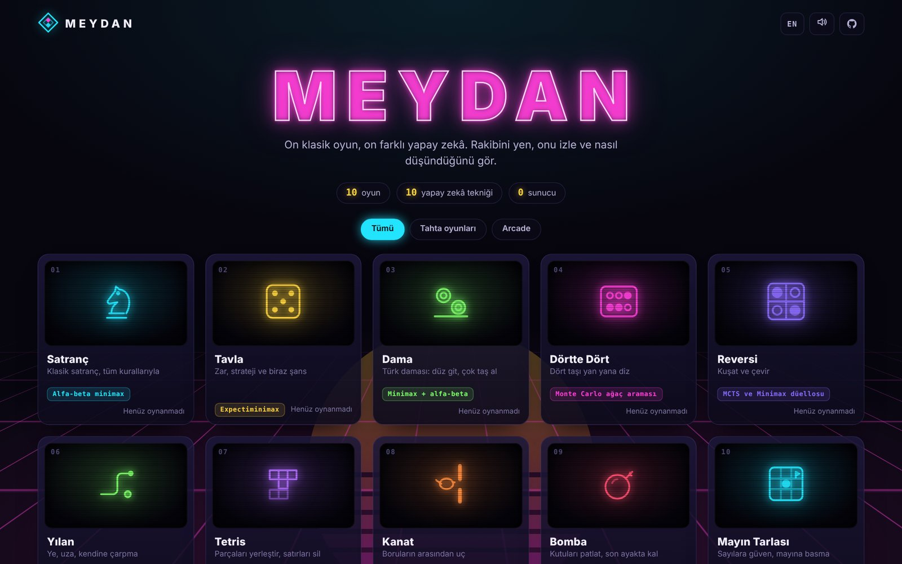

> 🇹🇷 **Türkçe özet:** Meydan, on klasik oyundan oluşan bir arcade. Her oyunda farklı bir yapay zekâ tekniği var: alfa-beta minimax, expectiminimax, Monte Carlo ağaç araması, A*, olasılıksal kısıt çözücü, genetik algoritma ve nöroevrim. Her oyunun yanındaki **Yapay Zekâ Konsolu**, yapay zekânın o an ne hesapladığını gösterir: düşündüğü hamle dizisini, karşılaştırdığı adayları, kazanma tahminini, sinir ağının nasıl çalıştığını. Rakibini yenebilir, iki yapay zekâyı birbirine oynatabilir ya da kuşların uçmayı kendi kendine öğrenmesini izleyebilirsin. Sunucu yok; her şey tarayıcıda çalışır.

## The ten cabinets

| | Game | AI technique | What the console shows |
|---|---|---|---|
| 01 | **Chess** | Alpha-beta minimax, iterative deepening, quiescence search, MVV-LVA and killer-move ordering, piece-square tables | Evaluation bar, principal variation, top five candidate moves with scores, depth, nodes and speed, plus an arrow on the board for the move it is considering |
| 02 | **Backgammon (Tavla)** | Expectiminimax: averages over all 21 possible dice rolls instead of assuming one reply | Win probability, the candidate moves with their expected win rate, pip counts, positions evaluated |
| 03 | **Turkish draughts (Dama)** | Minimax with alpha-beta that keeps searching while captures are pending | Evaluation, principal variation, candidate moves, depth and nodes |
| 04 | **Connect Four** | Monte Carlo Tree Search (UCT) with no game knowledge at all | Live heat map over the columns: how many simulations each move received and how often it won |
| 05 | **Reversi** | Two AIs: MCTS and a positional minimax. A **duel mode** lets them play each other and keeps score | Per-square scores of the AI to move, its estimate, the running duel score |
| 06 | **Snake** | A* that knows when each body segment will move away, plus a safety check: it only goes for the food if it can still reach its own tail afterwards | The planned path, every cell A* explored, the current strategy (food, follow the tail, flee to open space) |
| 07 | **Tetris** | Searches every rotation and column (and looks one piece ahead), scoring boards by height, holes, bumpiness and lines. An **evolution lab** evolves those weights with a genetic algorithm | The target placement on the board, the features and top candidates, the weight vector, a live chart of the GA generations |
| 08 | **Flap** | Neuroevolution: 80 birds, each with a 5-6-1 neural network; the furthest flyers breed and mutate | The best bird's network with live activations, generation stats, best score per generation. You can then race the champion |
| 09 | **Blast** | Bots build a **danger map** (which cell burns, and when, including chain reactions) and use BFS to escape, dig, collect power-ups and hunt. A bomb is only dropped if an escape route exists | The danger map over the arena, each bot's path and intent (fleeing, hunting, digging...) |
| 10 | **Minesweeper** | Probabilistic constraint solver: splits the unknown border into independent groups, counts every consistent mine layout and weights it by how many ways the remaining mines fit elsewhere | The mine probability of every closed cell, certain-safe and certain-mine counts, and the reasoning log |

| Chess: alpha-beta | Backgammon: expectiminimax |
|---|---|
| 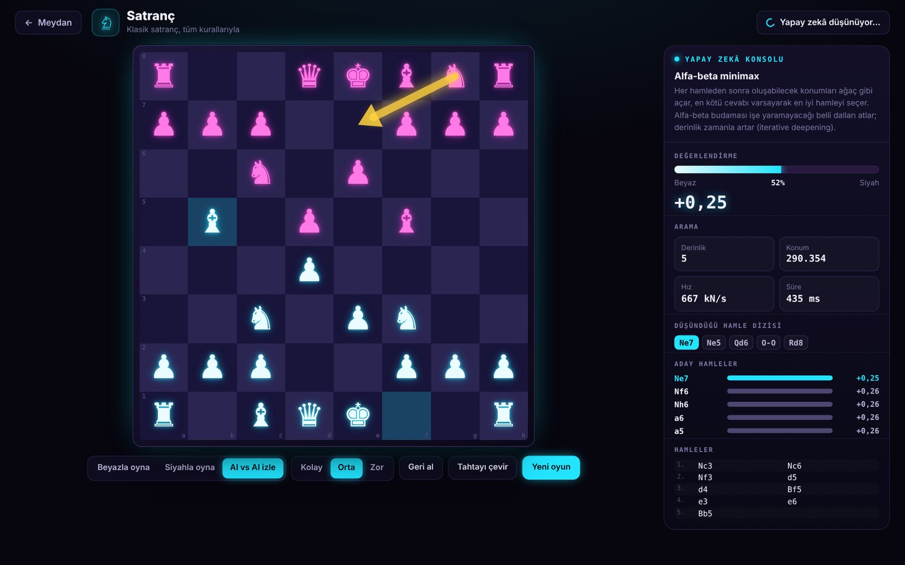 | 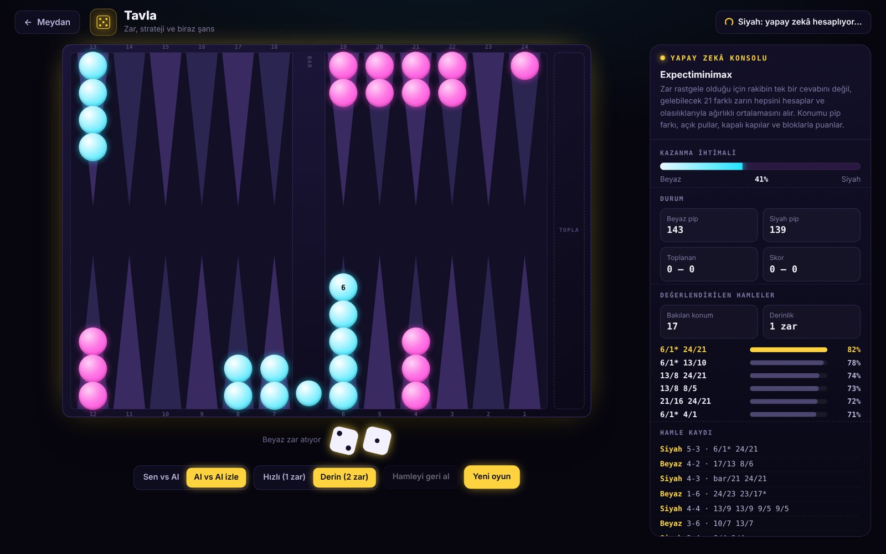 |

| Connect Four: MCTS | Reversi: MCTS vs Minimax duel |
|---|---|
| 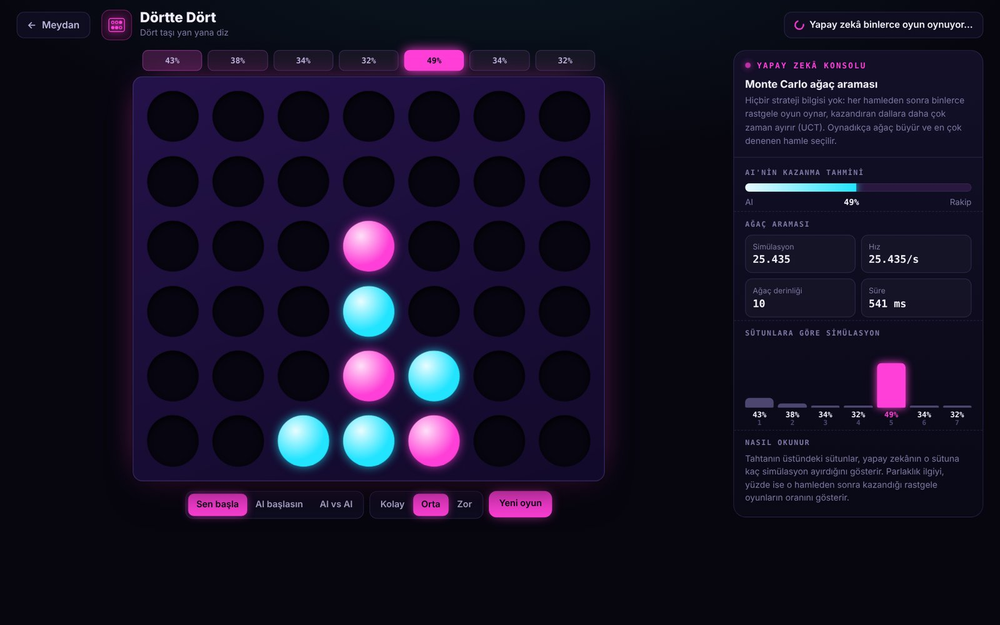 | 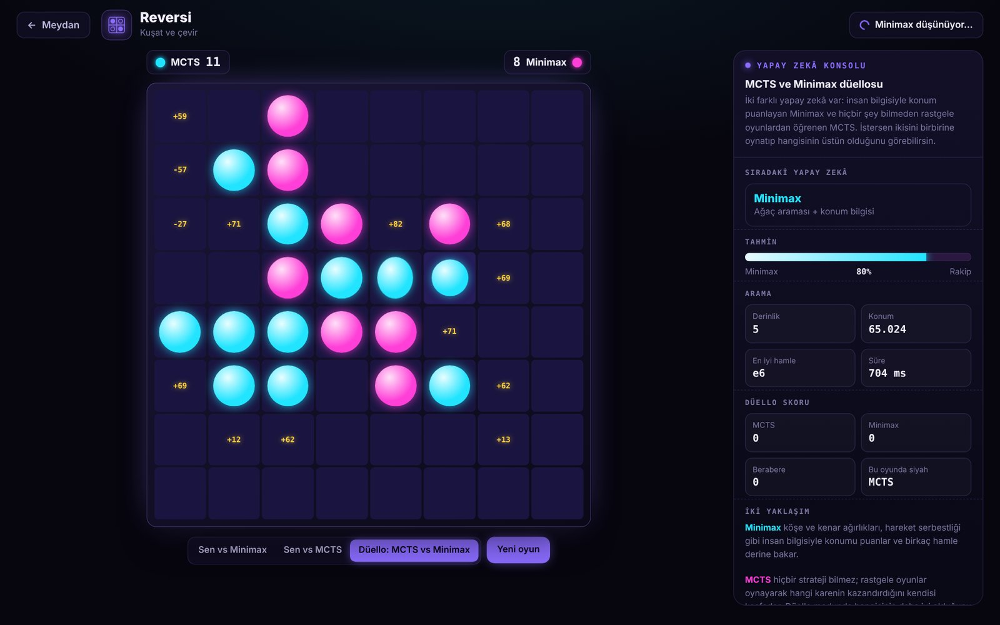 |

| Tetris: genetic algorithm | Flap: neuroevolution |
|---|---|
| 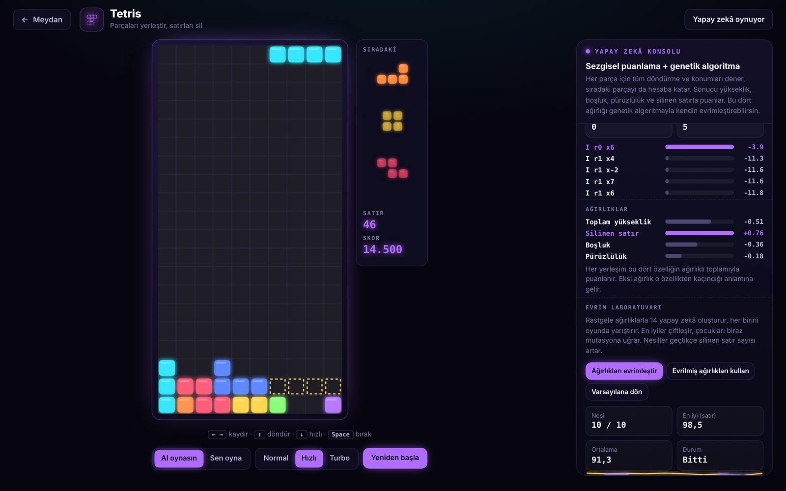 | 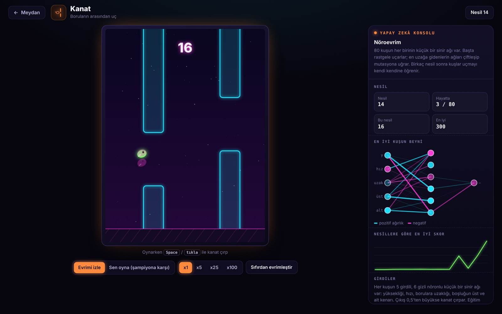 |

| Blast: danger map + BFS | Minesweeper: probability solver |
|---|---|
| 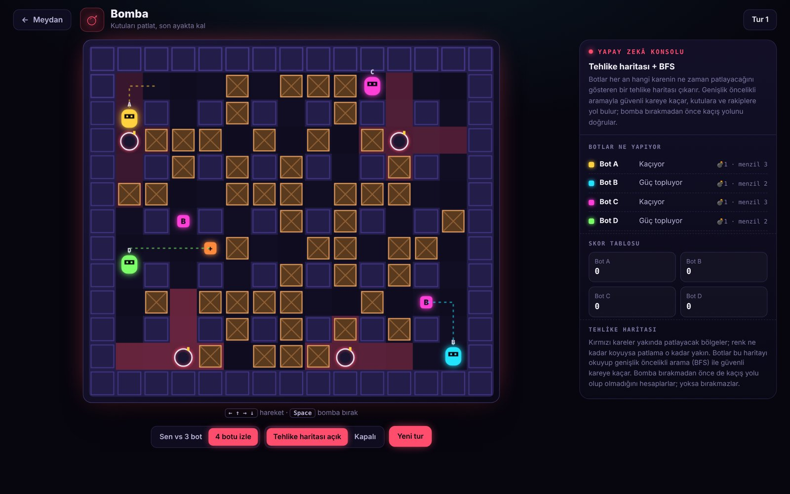 | 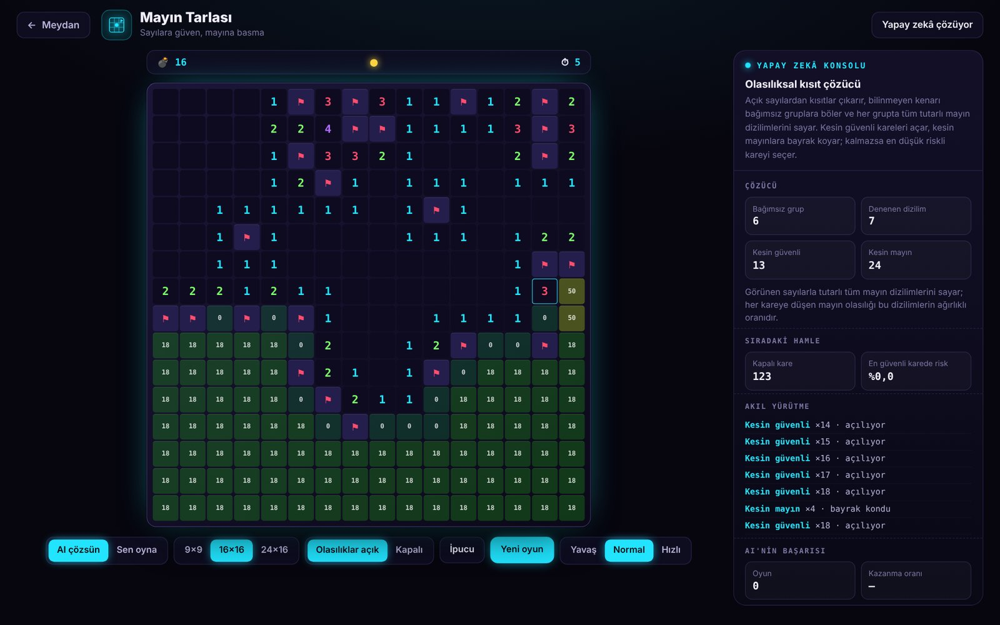 |

| Snake: A* | Turkish draughts | Mobile |
|---|---|---|
| 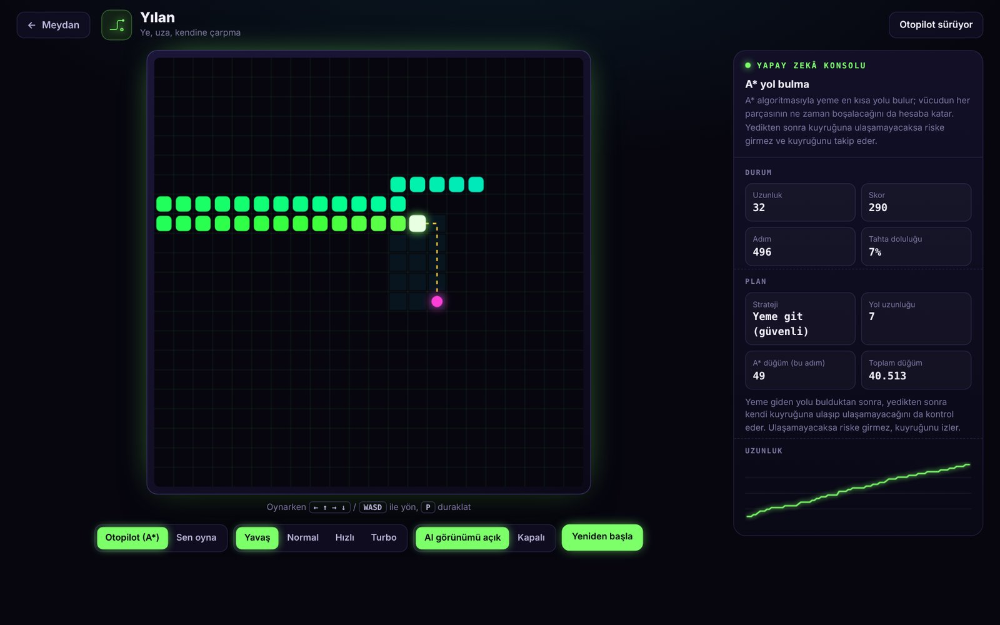 | 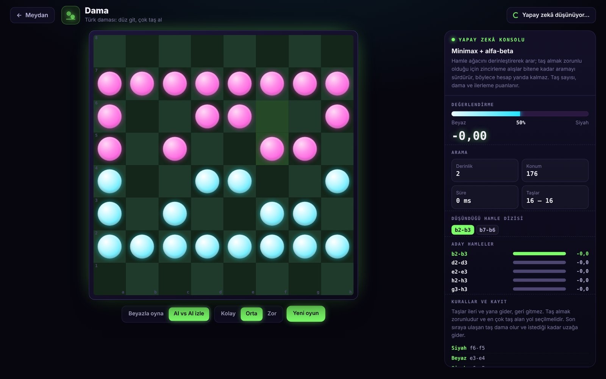 | 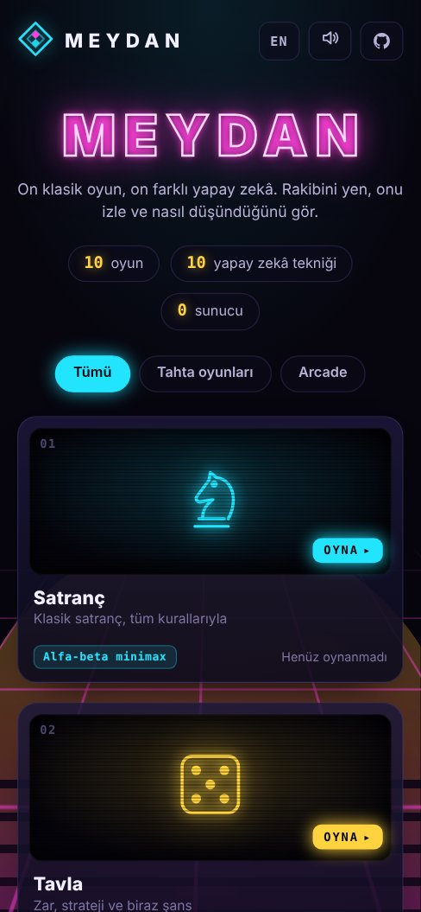 |

## How well do the AIs play?

Measured with the code in this repository, not estimated:

| | Result |
|---|---|
| Chess move generator | Matches the standard **perft** node counts on five reference positions (start position to depth 4 = 197,281; "Kiwipete" to depth 3 = 97,862; positions 3, 4 and 5), which covers castling, en passant, promotions and pins |
| Chess search | Roughly 400–650 thousand positions per second in the browser; reaches depth 5–7 in about a second in the middlegame. It finds short mates and wins hanging material, but it is a teaching engine, not Stockfish |
| Minesweeper solver | Wins **87%** of 300 intermediate games (16×16, 40 mines). The losses are forced guesses |
| Tetris | With the default weights it clears **~396 lines per 1,000 pieces** (400 is the maximum possible) |
| Flap | Birds typically learn to fly through hundreds of pipes within 10–15 generations, starting from random networks |
| Backgammon | Plays standard openings (for example 3-1 → 8/5 6/5) and hits blots in its home board. Its evaluation is hand-written, so it is a solid club player, not a neural-network bot |

## Architecture

```
src/
  main.ts              hash router: the arcade or a game
  ai.worker.ts         runs AI tasks off the main thread and streams progress
  core/                game shell, AI console widgets, i18n (TR/EN), sound, storage
  hub/                 the arcade lobby
  games/
    mcts.ts            generic Monte Carlo Tree Search, shared by Connect Four and Reversi
    handlers.ts        the tasks the worker can run
    chess/             engine.ts (0x88 board, legal moves, SAN), ai.ts (search), view.ts
    tavla/  dama/  connect4/  reversi/  snake/  tetris/  flappy/  bomber/  mines/
tests/                 Vitest suites for every engine and AI
```

- **Engines are pure TypeScript.** Rules and AIs have no DOM code, so the same module runs in the page, in the Web Worker and in the tests.
- **Progress streaming.** Long searches post intermediate results (each completed depth in chess, visit counts in MCTS, every generation in the GA), which is what makes the console "live".
- **Cancellation.** Starting a new game or leaving a cabinet terminates the worker, so a long search never blocks the next one.
- **No framework, no runtime dependencies.** Plain TypeScript, Canvas and DOM; Vite builds it into static files.

## Run it

The quickest way is the [online version](https://numanak-b221210105.github.io/meydan/). To run it locally you need [Node.js](https://nodejs.org) 20 or newer.

**Windows:** double-click `start.bat`
**macOS / Linux:** `./start.sh`

Or by hand:

```bash
npm install
npm run dev        # http://localhost:5173
npm test           # 51 tests
npm run build      # static site in dist/
```

CI runs type checks, tests and a production build on Windows, macOS and Linux with Node 20 and 22, and every push to `main` is deployed to GitHub Pages.

## Controls

| Game | Controls |
|---|---|
| Board games | Click a piece, then a highlighted square |
| Snake | Arrow keys or WASD, `P` to pause |
| Tetris | `←` `→` move, `↑` rotate, `↓` soft drop, `Space` hard drop |
| Flap | `Space` or click |
| Blast | Arrow keys to move, `Space` to drop a bomb |
| Minesweeper | Left click to open, right click to flag |

The language (Turkish / English) and sound can be switched from the top of the arcade. Records and win/loss counts are stored in the browser.

## Notes

- The Tavla rules follow standard backgammon (with *mars* counted as a double win); the doubling cube is not used.
- In Turkish draughts a man is promoted at the end of its move, and the game is drawn after 60 consecutive moves with no capture and no man moving.
- Game names in the arcade are generic; the games are original implementations and do not use any third-party assets.

## License

[MIT](LICENSE) © Numan AK
